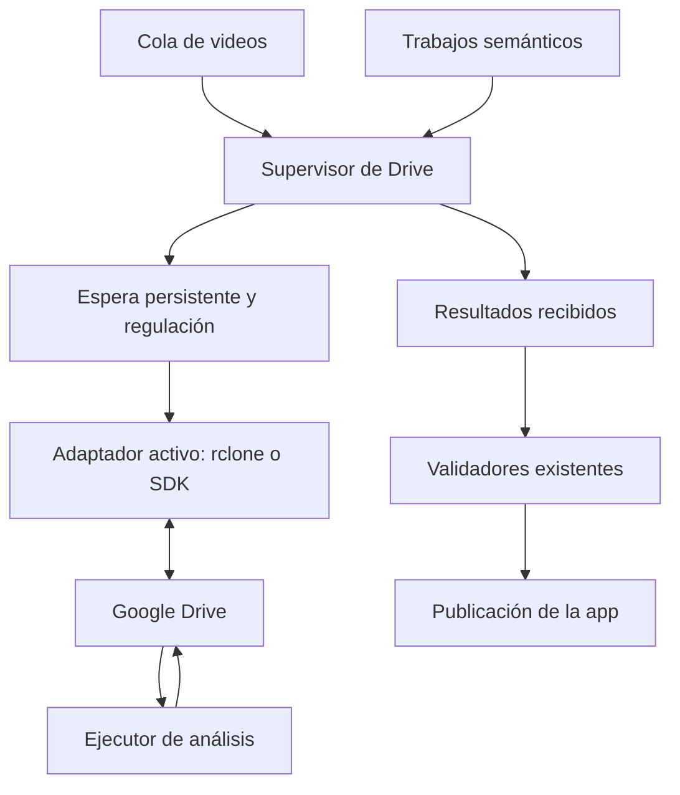

# Alternativas a rclone y capa de resiliencia para CryptoReport

Investigación: 14 de octubre de 2026. Alcance: comparación y propuesta; sin cambios
en servicios, credenciales, tareas, extracción ni publicación.

## Recomendación

Mantener inicialmente rclone, sustituir su OAuth compartido por un cliente propio
y poner las operaciones de Drive detrás de un supervisor persistente. Diseñar ese
supervisor para que pueda usar posteriormente el SDK oficial de Google sin cambiar
las colas, contratos de análisis ni validadores.

Esta recomendación es un juicio de encaje con el código y las restricciones
actuales, no un benchmark. Si la prioridad es control fino de cambios y errores,
el SDK oficial es la alternativa técnica preferida. Apps Script es la alternativa
más interesante para trasladar el transporte a Google con poca infraestructura
propia, a costa de otro entorno y sus límites.

El error reproducido es una cuota de Google. Todas las herramientas que accedan
a Drive siguen sometidas a sus límites. Cambiar de binario conservando el mismo
proyecto OAuth no elimina la cuota de ese proyecto. Google documenta límites y
respuestas 403/429, además de espera progresiva para errores temporales.
[Fuente: límites de Drive](https://developers.google.com/workspace/drive/api/guides/limits).

## Comparación

La carga operativa y el encaje de esta tabla son valoraciones para CryptoReport;
no se midió rendimiento, RAM o costo real de desplegar estas alternativas.

| Opción | Aporte principal | Carga operativa relativa | Límite relevante | Encaje |
| --- | --- | --- | --- | --- |
| rclone + OAuth propio + supervisor | Aprovecha el transporte actual, conserva contratos y permite recuperarse de cuotas | Baja frente a una migración completa | Continúa dependiendo de Drive; el supervisor no crea cuota nueva | Mejor primer paso |
| SDK oficial de Drive en Python | Control de errores estructurados, IDs y seguimiento incremental | Desarrollo inicial medio; encaja en los procesos Python existentes | OAuth y cuotas siguen siendo necesarios | Mejor alternativa para control y evolución |
| Google Apps Script como puente | Ejecuta transporte programado junto a Drive y puede entregar resultados al VPS | Otro despliegue pequeño y un endpoint estable en el servidor | Cuotas diarias y tiempo máximo por ejecución | Buena alternativa para lotes pequeños |
| n8n autohospedado | Editor visual, credenciales y operaciones de integración | Añade un servicio y su estado operativo | OAuth propio en autohospedado y límites de Google | Interesante si se centralizarán muchas automatizaciones |
| Windmill autohospedado | Flujos y scripts operativos con integración de Drive | Añade plataforma, workers y PostgreSQL | OAuth, recursos del servidor y disponibilidad de funciones por edición | Mayor alcance del necesario para corregir este transporte |

### 1. Conservar rclone

rclone documenta que su cliente de Drive predeterminado es compartido y está en
proceso de retirada durante 2026. Un cliente propio permite controlar el proyecto
que solicita la cuota; no garantiza ausencia de límites.
[Fuente: OAuth de rclone](https://rclone.org/drive/#making-your-own-client-id).

Sus opciones `--tpslimit` y `--tpslimit-burst` permiten regular transacciones. En
nuestro diseño, cada operación crea un proceso: hace falta coordinar también los
procesos de ambos módulos para que la regulación no quede aislada por comando.
Propuesta inicial: un solo trabajador de transporte y un límite conservador de
transacciones; ajustar después con mediciones. No presentar un límite de comandos
como un conteo exacto de peticiones HTTP internas.
[Fuente: opciones de rclone](https://rclone.org/docs/#tpslimit-float).

Variante: `rclone rcd` ofrece control HTTP y trabajos asíncronos con consulta de
estado. Puede simplificar una futura integración con el panel, pero añade otro
proceso residente. Sus identificadores de trabajo pertenecen a una instancia;
la cola durable de CryptoReport debe seguir siendo la referencia para recuperar
operaciones después de reinicios. Mantendría CLI al inicio por la frecuencia baja.
[Fuente: rclone Remote Control](https://rclone.org/rc/#running-asynchronous-jobs-with-async-true).

### 2. API oficial de Google Drive mediante Python

Google proporciona ejemplos con `google-api-python-client` y bibliotecas de
autenticación. La alternativa es implementar un adaptador que cumpla el contrato
local de listado, lectura y escritura, conservando el bridge y sus validaciones.
El ejemplo inicial de Google no basta como configuración de producción.
[Fuente: cliente Python](https://developers.google.com/workspace/drive/api/quickstart/python).

Es la opción con mayor control para este repositorio: permite trabajar directamente
con IDs y respuestas de error de Google, elegir los campos consultados y mantener
un cursor de cambios. La ventaja es flexibilidad, no quedar exento de cuotas.

La colección `changes` permite guardar un token y recuperar cambios posteriores.
Diseño propuesto: obtener token antes del inventario inicial, completar ese
inventario, consumir cambios desde el token y confirmar cada avance solo después
de procesarlo de forma durable. Filtrar a las carpetas autorizadas y descartar
metadatos ajenos sin conservarlos. Gestionar todas las páginas antes de declarar
una sincronización completa.
[Fuente: seguimiento de cambios](https://developers.google.com/workspace/drive/api/guides/manage-changes).

Las notificaciones push pueden avisar de cambios, pero no entregan el JSON del
resultado: después hay que consultar Drive. Los canales necesitan renovación.
Las consideraría cuando exista una dirección HTTPS estable; conservaría sondeo
de reconciliación aunque se añadieran avisos push.
[Fuente: notificaciones de Drive](https://developers.google.com/workspace/drive/api/guides/push).

### 3. Apps Script como puente de transporte

Propuesta de arquitectura, todavía sin desplegar:

1. El VPS expone una pequeña bandeja de trabajos autorizados por HTTPS.
2. Un trigger de Apps Script consulta esa bandeja y copia nuevos trabajos a Drive.
3. El mismo script detecta salidas nuevas en Resultados y las entrega al VPS.
4. El VPS valida, importa y confirma recepción. Solo entonces se avanza el cursor.

Apps Script dispone de triggers temporizados con permisos del usuario que los
crea. DriveApp permite operar con archivos; UrlFetchApp puede comunicarse con
el servidor. Estas capacidades sustentan la propuesta, sin requerir que el
ejecutor de análisis cambie cómo escribe sus resultados en Drive.
[Triggers](https://developers.google.com/apps-script/guides/triggers/installable),
[DriveApp](https://developers.google.com/apps-script/reference/drive/drive-app),
[UrlFetchApp](https://developers.google.com/apps-script/reference/url-fetch/url-fetch-app).

Límites verificados: seis minutos por ejecución y, para cuentas personales,
noventa minutos diarios de triggers. También existen cuotas de productos
asociados; no es una vía sin límites. Empezaría con lotes pequeños cada treinta
minutos, presupuesto corto por pasada y cursor persistente. Ese intervalo es
una propuesta para este producto, no una garantía del programador.
[Fuente: cuotas de Apps Script](https://developers.google.com/apps-script/guides/services/quotas).

Para llevarlo a producción faltan autorización inicial del usuario, un despliegue
del script y un endpoint HTTPS estable. El túnel temporal actual no acredita esa
estabilidad. La entrega al VPS necesitaría firma, fecha y protección contra
repeticiones; el servidor seguiría comprobando esquema, hashes, citas y job_id.
El script movería JSON: los análisis seguirían a cargo del ejecutor actual.

### 4. n8n

La edición Community autohospedada puede utilizarse sin suscripción a un plan
de pago, dentro de su licencia. Sigue requiriendo cómputo, mantenimiento y copias
de su estado; no equivale a costo operativo nulo.
[Fuente: ediciones](https://docs.n8n.io/hosting/community-edition-features/).

El trigger de Drive comprueba eventos periódicamente una vez publicado. En
autohospedado, la integración de Google requiere credenciales OAuth propias;
por tanto, instalar n8n no evita ese paso. Admite SQLite por defecto o PostgreSQL.
[Trigger de Drive](https://docs.n8n.io/integrations/builtin/trigger-nodes/n8n-nodes-base.googledrivetrigger),
[OAuth](https://docs.n8n.io/integrations/builtin/credentials/google/oauth-single-service/),
[Base de datos](https://docs.n8n.io/hosting/configuration/supported-databases-settings/).

Lo elegiría si el usuario quiere gestionar varias integraciones desde un editor
visual. Para el problema de cuota actual, duplicaría parte de la orquestación ya
presente. Los validadores de CryptoReport deberían seguir siendo la puerta de
publicación, aunque n8n transportara las salidas.

### 5. Windmill

Ofrece integración OAuth con Drive y ejecución de scripts/flujos; su documentación
describe triggers nativos de cambios. Autohospedarlo requiere configurar OAuth.
[Fuente: integración de Drive](https://www.windmill.dev/docs/integrations/gdrive).

Su despliegue utiliza PostgreSQL para el estado. Ese componente adicional importa
porque el usuario busca contener la carga del VPS. Es una plataforma que podría
evaluarse para un centro operativo más amplio; el encaje aquí no justifica migrar
solo para corregir la cuota del transporte. No se certificó qué edición cubriría
todo el diseño ni se hizo una cotización de licencias.
[Fuente: despliegue](https://www.windmill.dev/docs/advanced/self_host).

## Módulos intermedios propuestos

El repositorio ya tiene cola durable en SQLite, bloqueo entre procesos,
deduplicación, confirmación de subidas y caché por ID/fecha/tamaño. Se deben
conservar. La propuesta añade una política común de transporte a esa base:

El diagrama representa una propuesta; no acredita una ejecución de Schedule.

| Módulo | Responsabilidad | Comportamiento ante fallos |
| --- | --- | --- |
| Adaptador de transporte | Encapsular listado, lectura y escritura para los dos consumidores | Un adaptador activo por operación; conservar contratos al cambiar herramienta |
| Clasificador de errores | Distinguir cuota, autenticación, permisos, red, datos y duplicados | No tratar cualquier 403 como cuota ni reiniciar OAuth por un límite temporal |
| Cola de transporte | Persistir intención, intento, próximo intento, ID remoto y hash | Reiniciar sin perder subidas pendientes o inciertas |
| Regulador compartido | Coordinar concurrencia y frecuencia entre videos y cruces | Evitar que cada componente haga reintentos independientes |
| Pausa persistente por cuota | Recordar el enfriamiento entre ciclos y reinicios | Como propuesta inicial: pausas de 15, 30 y 60 minutos, con variación aleatoria y una sola prueba al reabrir |
| Publicador de control | Comparar contenido antes de escribir instrucciones e índices | Cero reescrituras cuando la versión efectiva no cambió |
| Observabilidad | Separar salud de Drive, análisis pendientes, bloqueos y publicación | No presentar un salto busy o un error parcial como sincronización completa/fallo total |

Los intervalos son parámetros iniciales propuestos, pendientes de medición. Ante
cuota, aumentar concurrencia o saltar automáticamente al SDK con el mismo proyecto
mantendría el mismo límite. Los reintentos deben ser acotados. Google recomienda
espera progresiva para errores de tasa; errores de autorización o permisos requieren
otro tratamiento.
[Fuente: manejo de errores](https://developers.google.com/workspace/drive/api/guides/handle-errors).

Para una escritura con respuesta incierta: primero reconciliar por carpeta,
identidad remota y hash. Confirmar si existe una única copia válida; ante versiones
distintas o duplicados, marcar conflicto. No volver a crear a ciegas. La publicación
solo ocurre después de los validadores existentes, independientemente del transporte.

## Cambios concretos que el research identifica en nuestro código

- `services/bridge/crbridge/core.py` ya aplica caché por ID/ModTime/Size en `read`;
  extender la coordinación a los consumidores sin sustituir esa caché.
- `services/bridge/crbridge/drive.py` reduce los errores a categorías de texto y
  desactiva reintentos internos. Incorporar política persistente fuera del comando,
  con detalles de error seguros para el panel.
- `services/social/crsocial/scheduled.py` publica el índice y las instrucciones
  semánticas en cada sincronización. Comparar versiones/contenido antes de escribir;
  separar el heartbeat local de los cambios efectivos de la cola.
- Ambos módulos deben compartir el enfriamiento: después de un rechazo por cuota
  en videos, los cruces no deberían iniciar otra ráfaga contra el mismo proyecto.
- Propuesta de frecuencia inicial: reconciliación cada treinta minutos, ajustable
  a una hora en reposo. Validar con el ritmo real del ejecutor y la antigüedad de
  sus resultados. No se cambió el timer durante esta investigación.

Se puede reutilizar la pequeña SQLite operativa para metadatos de transporte.
La propuesta inicial no requiere añadir un servidor PostgreSQL ni Redis al VPS.

## Costos, límites y decisiones

Ninguna de estas rutas requiere invocar un modelo por API para mover los archivos.
Los créditos de inferencia quedan fuera del transporte. El cómputo del servidor,
el almacenamiento y las cuotas de los productos siguen existiendo.

La documentación actual de Google distingue cuotas y umbrales de facturación;
no debe afirmarse que toda operación de Drive es gratuita sin condiciones.
Antes de desplegar un cliente propio, verificar los límites aplicables a ese
proyecto y mantener alertas. No se compraron servicios ni se activó facturación.
[Fuente: cuotas y umbrales](https://developers.google.com/workspace/drive/api/guides/limits).

No elegiría inicialmente otra plataforma de orquestación para corregir esta cuota.
Usaría rclone con cliente propio y supervisor; si se prioriza control fino desde
el primer despliegue, implementaría el adaptador oficial de Python bajo ese mismo
supervisor. Apps Script merece una prueba separada si se prefiere sacar el
transporte de Drive del VPS.

La capa propuesta asegura traslado, reanudación y validación. No puede producir
un análisis que el ejecutor todavía no haya emitido. La verificación de activación
y próxima ejecución de Schedule sigue siendo una comprobación independiente.

## Validación antes de adoptar una ruta

1. Lectura de carpetas autorizadas y de un trabajo real con el nuevo cliente.
2. Escritura controlada y lectura posterior, con comparación del contenido.
3. Cuota simulada: pausa durable, ausencia de ráfagas y recuperación tras reinicio.
4. Timeout después de subir: reconciliación sin duplicar archivos.
5. Ciclo sin cambios: ausencia de reescrituras de control.
6. Resultado editado, incompleto o de otra versión: rechazo sin publicar.
7. Al menos dos ejecuciones programadas reales: resultado, comprobante, importación
   y publicación contrastados. Distinguir pruebas manuales de ejecuciones periódicas.

No se ejecutaron pruebas de rendimiento ni despliegues comparativos. Este archivo
documenta capacidades verificadas en fuentes primarias y una propuesta para el
repositorio; no declara implementados los módulos descritos.
